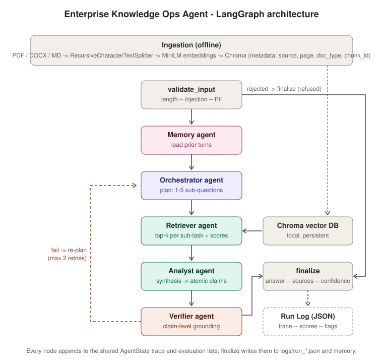
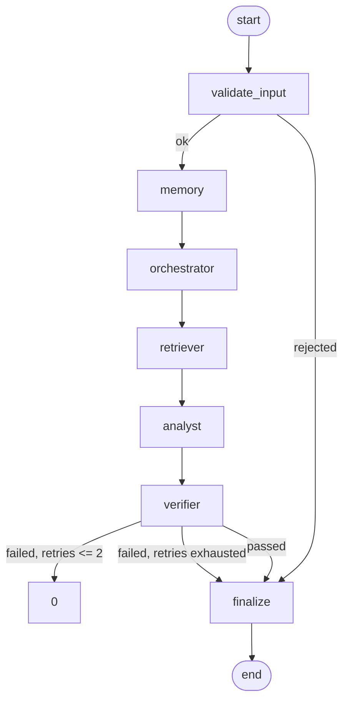

# Architecture and agent flow

## Agents and responsibilities

| Node | Agent | Input Output Decision it owns |
|---|---|---|---|---|
| `validate_input` | Guardrail | raw query | `input_ok`, `rejection_reason` | reject before any LLM call |
| `memory` | Memory | `conversation_id` | `history` | which prior turns to surface |
| `orchestrator` | Orchestrator | query, history, (on retry) unsupported claims | `plan` with 1-5 sub-tasks, rationale, dependencies, synthesis instruction | how to decompose and route |
| `retriever` | Retriever | plan | `chunks` with scores and metadata, `retrieval flags` | which evidence to admit |
| `analyst` | Analyst | chunks, synthesis instruction | `draft_answer`, `claims` (each tied to chunk ids),
| `noted_conflicts` | how to combine sources |
| `verifier` | Verifier | claims, chunks | `verdict`: per-clain label, grounding score, conflicts, pass/fail | whether the answer may be released |
| `finalize` |-| verdict, claims, chunks | `final_answer`, `sources`, `confidence` | how to present confidence and caveats |

## Control flow

Two conditional edges carry all routing logic (`graph.py`):

- `after_validation` - a rejected query skips every agent and goes straight to a refusal.
- `after_verifier` - the verifier, not the orchestrator, decides whether the loop continues. A failed verdict sends the unsupported claims back to the orchestrator, which re-plans with `REFINE_PROMPT`. The loop is bounded by `MAX_RETRIES`.

## State

`AgentState` (`state.py`) is a single TypedDict shared by all nodes, `trace` and `evaluation` use `operator.add` reducers so every node appends without overwritings everything else is replaced per attempt. This is what makes the decision trace and evaluation log complete without any extra plumbing.
as Models

## Models

| Role | Default (local) | Alternative |
|---|---|---|
| ALL agents | Ollama `qwen2.5:7b`, temperature 0, JSON mode | Azure OpenAI deployment |
| Embeddings | `all-MiniLM-L6-v2` (CPU) | `text-embedding-3-small` |
| Vector store | Chroma, persisted to `./chroma_db` |-|
Structured outputs are enforced with Pydantic schemas via `with_structured_output`, so a model change requires no code change.

## Out of scope (per the case study)

Cloud deployment, authentication, fine-tuning and a production UI. The included Streamlit page is a debugging aid, not a product surface.